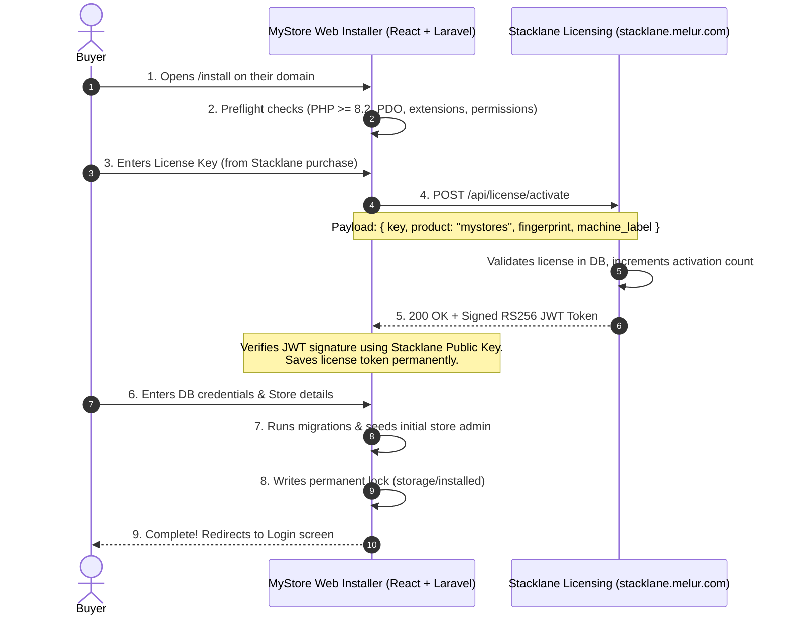

# MyStore — License Management & Buyer Installation Implementation Plan

**Author:** Antigravity  
**Date:** 2026-10-09  
**Target Project:** MyStore (Laravel 12 + React 19) + Flutter Companion App  
**Licensing Backend:** Stacklane (`stacklane.melur.com`)  
**Design Philosophy:** One-time install activation (No Heartbeat / No Cron), cryptographic token verification, standalone HTML buyer documentation, and frictionless self-hosted buyer installation.

---

## 1. Executive Summary

This plan outlines the architecture and execution steps to turn MyStore into a commercially sellable product for buyers on self-hosted environments (cPanel, VPS, Cloud).

### Key Directives:
1. **Reuse Stacklane**: Leverage the existing Stacklane licensing platform (`stacklane.melur.com`) using `product: "mystores"`.
2. **No Recurring Heartbeat / No Background Cron**: The app verifies the license **only at installation time** (and optionally during version updates). During daily operations, no phone-home or cron check runs.
3. **Cryptographic Validation**: Unlike UltimatePOS (which relied on an insecure plaintext HTTP response), MyStore verifies an **RS256 JWT token** using Stacklane's embedded Public Key.
4. **Zero Buyer Build Step**: The buyer will **not** need Node.js, npm, or Composer on their hosting. The release package comes pre-compiled with React assets in `public/` and ready-to-run PHP vendor dependencies.
5. **Standalone HTML Documentation**: A beautifully designed, self-contained `documentation.html` included in the root of the distribution zip, detailing complete setup steps for both the Website and Flutter mobile app.

---

## 2. Package Distribution Structure

When a buyer purchases MyStore on Stacklane, they receive a single zip archive (`mystores-v1.0.0.zip`) structured as follows:

```
mystores-v1.0.0/
├── web/                     # Pre-bundled Laravel 12 + compiled React 19 (Upload to cPanel)
├── documentation.html       # Comprehensive, standalone interactive HTML setup guide
└── README.txt               # Quick orientation file (links to web installer & Google Play app)
```

*(The Flutter mobile companion app is published as a universal app on Google Play Store; buyers and staff install directly from Google Play without compiling or sideloading).*

---

## 3. Architecture & Licensing Flow

### 3.1 The License Model
* **When is it verified?**
  * At initial installation wizard (`POST /api/install/activate-license`).
  * Stored permanently as a signed certificate (`storage/app/license.crt` and `settings` table).
  * (Optional) During major version upgrades.
* **No Daily/Weekly Cron**: No periodic pings or background network calls during normal store operations.

### 3.2 Activation Sequence



---

## 4. Server Fingerprint Specification

Stacklane's API requires:
* `product`: `"mystores"`
* `key`: Buyer's license key string
* `machine_label`: Human-readable label (e.g. `mystore.buyerdomain.com`)
* `fingerprint`: **Exact 64-character string** (`size:64`)

### Fingerprint Calculation in MyStore (PHP):
To bind the license to the buyer's server/domain without breaking on shared hosting:
```php
$domain = strtolower(parse_url(config('app.url'), PHP_URL_HOST) ?: request()->getHost());
$serverIdentity = php_uname('n') . '|' . dirname(base_path());
$fingerprint = hash('sha256', $domain . '|' . $serverIdentity); // Guaranteed 64-char hex
```

---

## 5. Buyer Installation Flow (Web Wizard UI/UX)

The installation wizard will be served directly at `/install` using MyStore's React frontend and Tailwind CSS design system.

### Step 1: Preflight Server Check
Validates that the host meets all requirements:
* **PHP Version**: `>= 8.2`
* **Extensions**: `pdo_mysql` / `pdo_sqlite`, `openssl`, `mbstring`, `curl`, `gd`, `zip`, `fileinfo`, `dom`
* **Directory Permissions**: `storage/` and `bootstrap/cache/` are writable (`0775` or `0755`)
* **Service Upsell**: Optional banner: *"Need hassle-free installation? Get our professional setup service."*

### Step 2: License Activation
* Input: **License Key** (purchased via Stacklane/Stripe/ToyyibPay).
* Action: Calls MyStore's backend `POST /api/install/activate-license`.
* MyStore connects via HTTPS with full SSL certificate verification to `https://stacklane.melur.com/api/license/activate`.
* Upon success, the RS256 token is validated against the embedded public key and cached.

### Step 3: Database Connection
* Inputs: Database Host, Port, Database Name, Username, Password.
* Features a **"Test Connection"** button (connects via PDO before writing anything).
* Writes parameters to `.env`.
* Generates a unique, cryptographically strong `APP_KEY` automatically (`Artisan::call('key:generate')`).

### Step 4: Database Migration & Seeding
* Runs `Artisan::call('migrate --force')`.
* Runs basic foundational seeders (system settings, default roles/permissions).

### Step 5: Initial Business & Admin Account Setup
* Admin Name, Email, Password.
* Store Name, Default Currency (MYR, USD, etc.), Timezone.

### Step 6: Installation Lockout
* Creates `storage/installed` file.
* Saves `installed_at` timestamp in the database.
* The `CheckInstalled` middleware locks `/install` permanently (returns 404 or redirects to `/login`).

---

## 6. Flutter Companion App Setup Specification

The Flutter app is shipped as part of the MyStore bundle with **no separate license check** (it authenticates directly with the buyer's self-hosted Laravel API).

### Method A: Zero-Compile Quick Setup (Using bundled `MyStore-v1.0.0.apk`)
1. Buyer installs `MyStore-v1.0.0.apk` directly on Android phones, tablets, or POS terminals.
2. On first launch, the app prompts: **"Connect Your Store"**.
3. The user either scans the QR code from their web dashboard (`Settings > Mobile App`) or types their domain: `https://store.buyerdomain.com`.
4. Staff logs in with their MyStore credentials.

### Method B: Developer Customization & Source Compilation
For buyers wanting custom branding or publishing to Google Play Store:
1. **Change Server URL**: Update `baseUrl` in `mobile/lib/core/api/api_endpoints.dart` (or pass `--dart-define=API_BASE_URL=...`).
2. **Change App Name**: Update `android:label` in `mobile/android/app/src/main/AndroidManifest.xml`.
3. **Change Package Name**: Update `applicationId` and `namespace` in `mobile/android/app/build.gradle.kts`.
4. **Change App Icon**: Replace `ic_launcher.png` inside `mobile/android/app/src/main/res/mipmap-*/`.
5. **Release Keystore**: Create `mobile/android/key.properties` with keystore credentials.
6. **Build Commands**:
   * Build APK: `flutter build apk --release`
   * Build Play Store Bundle: `flutter build appbundle --release`

---

## 7. Standalone HTML Documentation Specification (`documentation.html`)

A modern, self-contained HTML file styled with responsive CSS, a sidebar table of contents, copy-to-clipboard code blocks, and visual screenshots/callouts.

### Documentation Table of Contents:
1. **Welcome & Package Overview**:
   * Directory breakdown (`web/`, `mobile/`, `MyStore.apk`).
   * System requirements checklist (PHP 8.2+, MySQL 5.7+ / 8.0+, Apache/Nginx).
2. **Website Installation Guide**:
   * Step 1: Creating database and user in cPanel / phpMyAdmin.
   * Step 2: Uploading and extracting `web/` to document root.
   * Step 3: Running the web installer at `https://your-domain.com/install`.
   * Step 4: Activating your Stacklane License Key.
   * Step 5: Completing initial store and superadmin setup.
3. **Flutter Mobile App Setup Guide**:
   * **Quick Mode**: Installing the pre-built APK and connecting via Store QR Code.
   * **Developer Mode (Building from Source)**:
     * Prerequisite tools (Flutter SDK, Android Studio).
     * Modifying API domain (`api_endpoints.dart`).
     * White-labeling (App Name, Package Name, Icons).
     * Android keystore signing (`key.properties`).
     * Compiling release APK and Play Store App Bundle.
4. **Marketplace Integration Setup**:
   * Connecting Shopee Open Platform credentials (Partner ID, Partner Key).
   * Connecting Lazada Open Platform credentials (App Key, App Secret).
   * Registering authorized OAuth redirect callbacks.
5. **Troubleshooting & FAQs**:
   * Resolving 500 Internal Server Error (directory permissions 755 / 644).
   * MySQL connection failures & privilege troubleshooting.
   * Invalid license error troubleshooting.
   * Removing `/public` from URL with `.htaccess` mod_rewrite.

---

## 8. Technical Implementation Components

### Component 1: Stacklane Configuration
* Register `product = "mystores"` in Stacklane's product catalog / plans.
* Verify public/private key pair on `stacklane.melur.com`.

### Component 2: MyStore Licensing Service (`backend/app/Services/Licensing/LicenseService.php`)
* Embeds the Stacklane Public Key.
* Implements:
  * `activate(string $licenseKey, string $domain): array`
  * `verifyToken(string $token): bool` (verifies RS256 signature using `openssl_verify`)
  * `getSavedLicense(): ?array`

### Component 3: Installer Controller (`backend/app/Http/Controllers/InstallController.php`)
Endpoints:
1. `GET /api/install/status`: Returns whether MyStore is already installed.
2. `GET /api/install/preflight`: Runs PHP version, extension, and permission checks.
3. `POST /api/install/test-db`: Tests PDO connection.
4. `POST /api/install/activate-license`: Connects to Stacklane and validates key.
5. `POST /api/install/execute`: Writes `.env`, migrates database, creates superadmin, creates lock file.

### Component 4: Installation Guard Middleware (`backend/app/Http/Middleware/CheckInstallation.php`)
* If `storage/installed` **does NOT exist**: Redirects all web requests to `/install`.
* If `storage/installed` **exists**: Blocks all `/install` routes and returns 404.

### Component 5: React Installer Page (`frontend/src/pages/InstallWizard.tsx`)
* A step-by-step wizard matching MyStore's design aesthetic (Tailwind CSS, clean status badges, loading states).

### Component 6: Standalone HTML Documentation Generator (`docs/documentation.html`)
* Beautiful, standalone single-file HTML documentation covering both Web and Mobile installation.

### Component 7: Packaging Script (`scripts/package-release.ps1`)
* Compiles React frontend (`npm run build`) into `backend/public/`.
* Runs `composer install --no-dev --optimize-autoloader` in `backend/`.
* Compiles Flutter release APK (`flutter build apk --release`).
* Copies `documentation.html` and `README.txt`.
* Creates a clean, ready-to-unzip archive `mystores-v1.0.0.zip`.

---

## 9. Phased Implementation Roadmap

```
[ Phase 1: Stacklane Prep & License Service ]
        │
        ▼
[ Phase 2: Web Installer Backend & Security Guard Middleware ]
        │
        ▼
[ Phase 3: React Installer Wizard UI ]
        │
        ▼
[ Phase 4: Standalone HTML Documentation (Website + Flutter) ]
        │
        ▼
[ Phase 5: Release Packaging Pipeline (Web + Flutter APK + Docs) ]
        │
        ▼
[ Phase 6: Verification & End-to-End Testing ]
```

### Phase 1: Stacklane Prep & License Service
- Verify Stacklane accepts `product: "mystores"`.
- Embed Stacklane Public Key in `backend/app/Services/Licensing/LicenseService.php`.

### Phase 2: Backend Installer API & Security Guard
- Create `backend/app/Http/Controllers/InstallController.php`.
- Create `backend/app/Http/Middleware/CheckInstallation.php`.
- Register routes for `/api/install/*`.

### Phase 3: Frontend Installer Wizard
- Build `frontend/src/pages/InstallWizard.tsx`.
- Add `/install` route to `App.tsx`.

### Phase 4: HTML Documentation
- Author comprehensive, responsive `docs/documentation.html` covering both web and mobile setup.

### Phase 5: Packaging Script
- Implement `scripts/package-release.ps1` to assemble `web/`, `mobile/`, `MyStore.apk`, `documentation.html`, and `README.txt`.

### Phase 6: End-to-End Testing & Verification
- Test fresh install flow on local SQLite/MySQL.
- Verify license activation against Stacklane.
- Verify lock out behavior after installation.
- Check compilation errors across backend, frontend, and mobile.

---

## 10. Approval Request

This document represents the complete plan for MyStore's licensing, buyer installation system, and standalone HTML documentation for both the website and Flutter mobile app.

> **Status:** Awaiting explicit user approval before proceeding to Phase 1 / Phase 2 execution.
