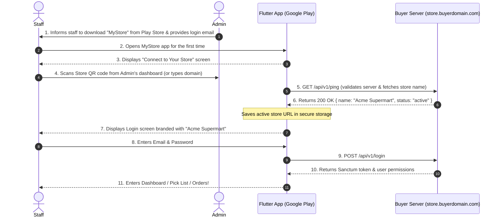

# MyStore — Google Play Store App & Dynamic Store Connection Implementation Plan

**Author:** Antigravity  
**Date:** 2026-10-10  
**Target:** MyStore (Laravel 12 + React 19) + Flutter Companion App  
**Distribution Model:** 
* **Website Package**: Distributed via Stacklane zip (`web/` + `documentation.html`) with zero buyer build step.
* **Mobile App**: Universal companion app downloaded directly from **Google Play Store**.

---

## 1. Executive Summary & Design Principles

Instead of forcing buyers to compile Flutter from source code or sideload raw APKs, MyStore adopts the **universal app model** (used by Slack, Mattermost, Nextcloud, and Shopify POS).

### Key Principles:
1. **Zero Mobile Build for Buyers**: Buyers only download and upload the website to their server/cPanel.
2. **Official Google Play Presence**: A single official app (`com.stacklane.mystore` or `com.terranoss.mystore`) published by the seller on Google Play.
3. **No Over-Engineering**:
   * Uses existing **Email + Password** authentication.
   * No complex cross-server sync, SMS verifications, or global databases.
   * Server connection via **Store QR Code** or direct URL typing.
4. **Multi-Store Flexibility (Option A: Switch Store)**:
   * Staff can easily switch stores or re-scan a QR code at any time from the app without reinstalling.

---

## 2. Package Distribution Comparison

```
[Buyer Purchases on Stacklane]
             │
             ▼
   mystores-v1.0.0.zip
   ├── web/                    (Pre-bundled Laravel 12 + compiled React 19)
   ├── documentation.html      (Standalone setup guide)
   └── README.txt              (Quick start instructions)
```

> **Note:** The `mobile/` source code and manual `.apk` are **excluded** from the standard buyer package. The buyer and their team download the companion app directly from Google Play.

---

## 3. End-to-End User Flow

### 3.1 Admin Setup Flow
1. Buyer installs MyStore web application on their domain (`https://store.buyerdomain.com`).
2. Admin logs into the web dashboard and goes to **Settings > Team** or **Mobile App**.
3. Admin sees:
   * **Google Play Badge**: Link & QR code to download the official mobile app.
   * **Store Connection QR Code**: Dynamically encodes `https://store.buyerdomain.com`.
   * **Team Member Management**: Admin adds staff members with Name, Email, and temporary password.

### 3.2 Staff Member Onboarding Flow


### 3.3 "Switch Store" Flow (For Multi-Store / Multi-Branch Staff)
1. Staff member works at Store A today and Store B tomorrow.
2. In the mobile app:
   * **If logged in**: Profile / Drawer menu $\rightarrow$ tap **"Switch Store / Disconnect"**.
   * **If on login screen**: A prominent text link at the top: *"Connected to store.buyerdomain.com • [Change Store]"*.
3. Tapping **"Change Store"** returns to the scanner screen to connect to Store B.

---

## 4. Technical Specifications & Architecture

### Component 1: Buyer Server Public Ping Endpoint (Laravel)
A lightweight public endpoint allowing the Flutter app to verify connectivity and retrieve store identity:
* **Endpoint**: `GET /api/v1/ping` or `GET /api/v1/store-info`
* **Authentication**: None (Public)
* **Response**:
```json
{
  "app": "mystore",
  "version": "1.0.0",
  "name": "Acme Supermart",
  "logo_url": null,
  "currency": "MYR",
  "status": "ready"
}
```

### Component 2: Dynamic Store Connection in Flutter
Currently, [api_endpoints.dart](file:///d:/GitHub/mystores/mobile/lib/core/api/api_endpoints.dart#L5) has a hardcoded static URL:
```dart
static const String baseUrl = 'https://mystores.melur.com/api';
```

#### Refactoring Plan:
1. **Store Connection Storage (`ServerStorage`)**:
   * Uses `flutter_secure_storage` to persist `active_store_url` and `active_store_name`.
2. **Dynamic Base URL in `ApiClient`**:
   * Update [api_client.dart](file:///d:/GitHub/mystores/mobile/lib/core/api/api_client.dart) so `BaseOptions.baseUrl` is dynamically injected or updated from `ServerStorage`.
3. **New UI Screen: `StoreConnectScreen` (`mobile/lib/features/auth/store_connect_screen.dart`)**:
   * Option 1: **"Scan Store QR Code"** using the camera (`mobile_scanner` package).
   * Option 2: **"Enter Store URL"** input field (e.g. `store.buyerdomain.com` with auto `https://` prefixing).
   * **Validation**: Calls `/api/v1/store-info` before saving.
4. **Login Screen Integration ([login_screen.dart](file:///d:/GitHub/mystores/mobile/lib/features/auth/login_screen.dart))**:
   * Header display: `Connecting to: Acme Supermart` with a small **"Change Store"** button.
   * Retains existing Riverpod `authProvider.login(email, password)`.

### Component 3: Admin Dashboard Mobile Setup Card (React 19)
In `frontend/src/pages/Team.tsx` or `Settings.tsx`:
* **Card Title**: *"MyStore Companion Mobile App"*
* **Badge**: Official *"Get it on Google Play"* graphic linking to the Play Store.
* **Store Connection QR Code**:
  * Generated client-side using `qrcode.react` (or lightweight SVG renderer).
  * Payload: Current browser origin (`window.location.origin`).
* **Instructions for Admin**:
  * 1. Ask staff to install the app from Google Play.
  * 2. Have staff scan this Store QR code.
  * 3. Staff logs in with their team email and password.

---

## 5. Phased Implementation Roadmap

```
[ Phase 1: Backend Store Info Endpoint ]
                 │
                 ▼
[ Phase 2: Web Admin QR & App Onboarding UI ]
                 │
                 ▼
[ Phase 3: Flutter Dynamic Base URL & StoreConnectScreen ]
                 │
                 ▼
[ Phase 4: "Switch Store" Capability in Mobile ]
                 │
                 ▼
[ Phase 5: Google Play Preparation (App Bundle & Keystore) ]
                 │
                 ▼
[ Phase 6: Documentation & Package Script Update ]
```

### Phase 1: Backend Store Info Endpoint
- Add `GET /api/v1/store-info` route and controller method in `backend/`.
- Ensure it returns store name, app signature, and currency without requiring authentication.

### Phase 2: Web Admin QR & App Onboarding UI
- Add QR code generation in `frontend/src/pages/Team.tsx` (using `window.location.origin`).
- Add "Download on Google Play" banner with setup guide for team members.

### Phase 3: Flutter Dynamic Base URL & StoreConnectScreen
- Add `mobile_scanner` dependency to `mobile/pubspec.yaml`.
- Create `ServerStorage` to save and retrieve active store URL.
- Update `createDio()` in `mobile/lib/core/api/api_client.dart` to read dynamic base URL.
- Implement `StoreConnectScreen` with camera scanner and manual domain input.
- Update router (`go_router`) to check if a store URL is configured; if not, redirect to `/connect-store`.

### Phase 4: "Switch Store" Capability
- On `LoginScreen`: Add a "Switch Store" header button that clears active store URL and navigates to `/connect-store`.
- In App Drawer / Settings: Add "Disconnect / Switch Store" action.

### Phase 5: Google Play Preparation
- Prepare app metadata (app name, icons, release keystore).
- Configure Android permissions for camera (`android.permission.CAMERA` in `AndroidManifest.xml`).
- Build release Android App Bundle (`.aab`): `flutter build appbundle --release`.

### Phase 6: Documentation & Package Script Update
- Update [MYSTORE-LICENSE-AND-INSTALL-IMPLEMENTATION-PLAN.md](file:///d:/GitHub/mystores/Docs/MYSTORE-LICENSE-AND-INSTALL-IMPLEMENTATION-PLAN.md) to reflect this architecture.
- Update `scripts/package-release.ps1` to exclude `mobile/` from the buyer distribution zip.
- Update `documentation.html` to instruct buyers to download the official mobile app from Google Play.

---

## 6. Verification & Testing Checklist

- [ ] **Store Info API**: Test `GET /api/v1/store-info` responds correctly in fresh installation.
- [ ] **QR Code Scanning**: Test scanning store URL from phone camera connects instantly.
- [ ] **Manual URL Entry**: Test typing domain with/without `https://` (e.g. `myshop.test` or `https://myshop.test`).
- [ ] **Login Flow**: Test standard email + password login against self-hosted instance.
- [ ] **Switch Store**: Test switching from Store A to Store B and verifying API calls hit the new domain.
- [ ] **Buyer Package Audit**: Verify `mystores-v1.0.0.zip` contains only `web/`, `documentation.html`, and `README.txt`.
