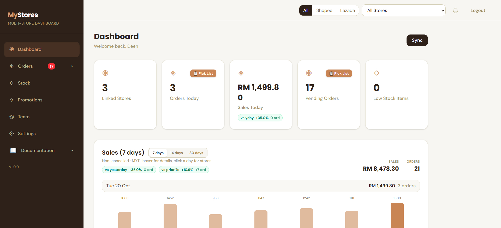
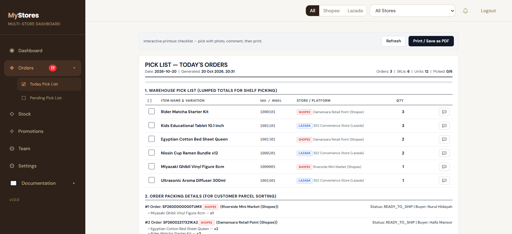
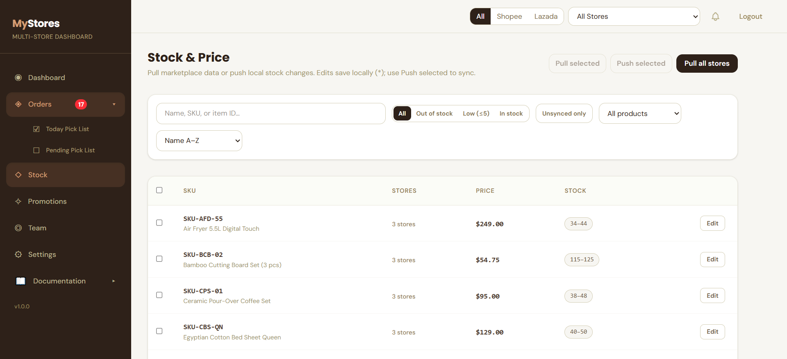

# MyStores — Multi-Store E-Commerce & Retail Management Application

**English** | [Bahasa Melayu](README.ms.md)

> **Self-Hosted Multi-Marketplace Store Management Platform**  
> Manage products, stock, pricing, orders, fulfillment, pick lists, and promotions across your **Shopee** and **Lazada** stores from a single unified web interface.

---

## 🌟 Key Features

- **Multi-Marketplace Integration** — Connect multiple Shopee and Lazada seller accounts via OAuth 2.0 with automated token refresh.
- **Unified Inventory & Stock Sync** — Cross-store SKU-grouped stock and price updates with asynchronous background queue processing.
- **Centralized Order Fulfillment** — Unified orders management, cancellation workflows, shipment booking, and bulk PDF shipping label generation (`dompdf`).
- **Warehouse Pick Lists** — Daily pick lists with photo completions, team commentary, and status tracking.
- **Automated Background Jobs** — Built-in scheduler for order polling, token rotation, and customer data compliance hygiene.
- **Self-Hosted Web Installer** — Zero-friction 4-step wizard for PHP server checks, database configuration, and admin onboarding.

---

## 📸 Screenshots

### Dashboard
Sales overview, linked stores, pending orders, and low-stock alerts at a glance.



### Today's Pick List
Interactive printout checklist — pick with photo, comment, then print.



### Stock & Price
Pull marketplace data or push local stock changes across all connected stores.



---

## 📦 Release Package

Pre-compiled production-ready release archives are provided in the [`release_artifacts/`](release_artifacts/) directory:

- **Download:** [`release_artifacts/mystores-v1.1.1.zip`](release_artifacts/mystores-v1.1.1.zip)

The release archive includes:
1. `web/` — Pre-built Laravel 12 API backend + compiled React 19 single-page application ready to upload to any cPanel or VPS web root.
2. `documentation.html` — Interactive step-by-step setup and operations manual.
3. `README.txt` — Quick orientation reference.

---

## 📋 Prerequisites

Before you begin, make sure you have the following ready:

1. **Shopee Open Platform account** (required to connect Shopee stores) — apply for free at [https://open.shopee.com/](https://open.shopee.com/)
2. **Lazada Open Platform account** (required to connect Lazada stores) — apply for free at [https://open.lazada.com/](https://open.lazada.com/)
3. **Web hosting + domain** with a MySQL database — for the cPanel or VPS environment described below

*(Only one marketplace account is strictly required to get started — connect Shopee, Lazada, or both.)*

---

## 🚀 Quick Start (5 Minutes)

1. **Upload Files:**  
   Extract and upload the contents of the `web/` directory to your web hosting root (e.g., `public_html` or domain document root).

2. **Create Database:**  
   Create an empty MySQL database and database user with full privileges in your hosting control panel.

3. **Run Web Setup Wizard:**  
   Open your browser and navigate to:
   ```
   https://your-domain.com/install
   ```
   Follow the 4-step on-screen setup wizard:
   - **Step 1: Preflight Check** (verifies PHP version and extension requirements)
   - **Step 2: Database Connection** (tests and saves MySQL connection)
   - **Step 3: Admin & Store Setup** (creates your store and administrator account)
   - **Step 4: Initialization** (runs database migrations and locks installer)

4. **Configure Background Cron Jobs:**  
   Add the following two cron entries in your hosting panel (cPanel Cron Jobs or `crontab -e`):
   ```cron
   # Queue worker (processes asynchronous marketplace stock pushes):
   * * * * * /usr/local/bin/php /path-to-mystore/artisan queue:work --stop-when-empty --timeout=600 >> /path-to-mystore/storage/logs/queue.log 2>&1

   # Scheduled tasks (Shopee & Lazada order polling, token rotation):
   * * * * * /usr/local/bin/php /path-to-mystore/artisan schedule:run >> /path-to-mystore/storage/logs/scheduler.log 2>&1
   ```
   *(Note: Adjust the PHP path and folder path to match your server).*

---

## 💻 Server Requirements

- **PHP:** `^8.2`
- **Extensions:** `pdo`, `pdo_mysql`, `openssl`, `mbstring`, `curl`, `gd`, `zip`, `fileinfo`
- **Database:** MySQL 8.0+ or MariaDB 10.4+
- **Web Server:** Apache (with `mod_rewrite` enabled) or Nginx

---

## 📖 Documentation

For detailed installation instructions, server optimization, and marketplace API configuration:
- Open [`Docs/documentation.html`](Docs/documentation.html) in your browser.

---

## 🛠️ Installation Service

Prefer someone else to handle the setup for you?  
If you need assistance deploying MyStores to your cPanel or VPS hosting, setting up the database, configuring cron jobs, or getting your marketplace APIs connected, an installation service is available on Shopee:

👉 **[Order Installation Service on Shopee](https://shopee.com.my/product/61084342/47869625790/)**

---

## 📄 License

This software is provided under the terms described in the documentation and release package.

